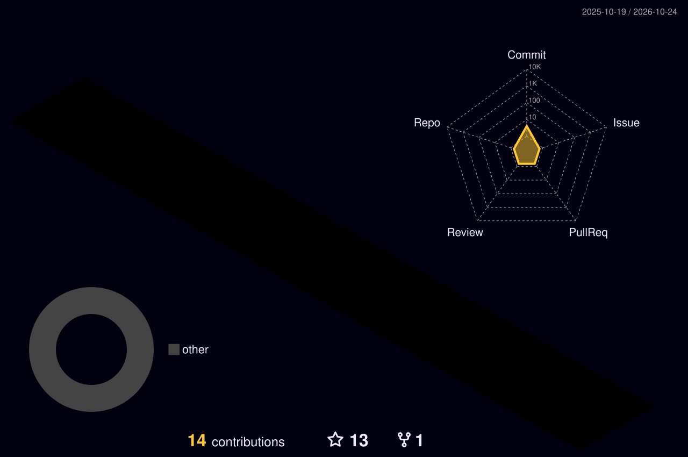

<!-- ===================== HEADER ===================== -->
<p align="center">
  
</p>

<p align="center">
  <a href="https://github.com/Acurich">
    
  </a>
</p>

<p align="center">
  
  
  
</p>

<!-- ===================== ABOUT ===================== -->
## `> whoami`

```cpp
#include <iostream>

struct Acurich {
    std::string location   = "Worldwide";
    std::string role       = "AI automation developer";
    std::string daily_work = "n8n workflows · AI agents · LLM integrations";
    std::string main_stack = "C++ · Python · Go · C#";
    std::string also_use   = "Java · TypeScript · React · Node.js · Django";
    std::string motto      = "If it can be automated — it will be.";
};
```

<!-- ===================== SKILLS ===================== -->
## `> stack --list`

<p align="center">
  
  <br/>
  
</p>

<p align="center">
  
  
  
  
</p>

<!-- ===================== STATS ===================== -->
## `> stats --verbose`

<p align="center">
  
</p>

<!-- 3D-календарь контрибуций: файл генерирует GitHub Action (.github/workflows/profile-3d-contrib.yml) -->
<p align="center">
  
</p>

<!-- ===================== CONTACTS ===================== -->
## `> connect`

<p align="center">
  <a href="https://t.me/acurich"></a>
  <a href="mailto:acurich123@gmail.com"></a>
</p>

<!-- ===================== FOOTER ===================== -->
<p align="center">
  
</p>
