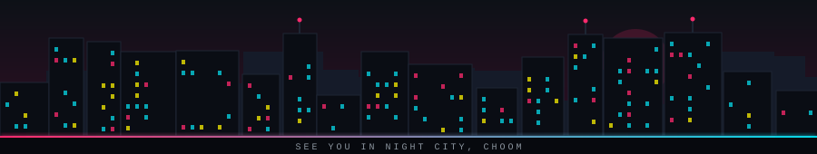

<!-- ===================== HEADER ===================== -->
<p align="center">
  
</p>

<p align="center">
  <a href="https://github.com/Acurich">
    
  </a>
</p>

<p align="center">
  
  
  
</p>

<!-- ===================== ABOUT ===================== -->
## `> whoami`

<p align="center">
  
</p>

<!-- ===================== SKILLS ===================== -->
## `> stack --list`

<p align="center">
  
  <br/>
  
</p>

<p align="center">
  
  
  
  
</p>

<!-- ===================== WHAT I BUILD ===================== -->
## `> ls ./what-i-build`

<p align="center">
  
</p>

<p align="center">
  <b>🤖 AI agents</b> that do routine work end-to-end &nbsp;·&nbsp;
  <b>⚙️ n8n workflows</b> that glue services together &nbsp;·&nbsp;
  <b>🧠 LLMs</b> inside real business processes
</p>

<!-- ===================== SKILL MATRIX ===================== -->
## `> skills --matrix`

<p align="center">
  
</p>

<!-- ===================== CONTACTS ===================== -->
## `> connect`

<p align="center">
  <a href="https://t.me/acurich"></a>
  <a href="mailto:acurich123@gmail.com"></a>
</p>

<!-- ===================== EASTER EGG ===================== -->
<details>
<summary><b>⚠️ breach protocol</b></summary>

```text
1C  BD  55  E9  1C
55  1C  E9  BD  7A
BD  7A  1C  55  E9

> uploading daemon... ACCESS GRANTED
> scanning visitor...

  status ........ curious
  threat level .. harmless
  coffee ........ CRITICALLY LOW

> deploying AI agent to fetch coffee... FAILED
  reason: agent built an n8n workflow to order coffee,
          then automated drinking it. 0 coffee left.

you read till the end, choom.
achievement unlocked: 🏆 Netrunner of the README
```

</details>

<!-- ===================== FOOTER ===================== -->
<p align="center">
  
</p>
